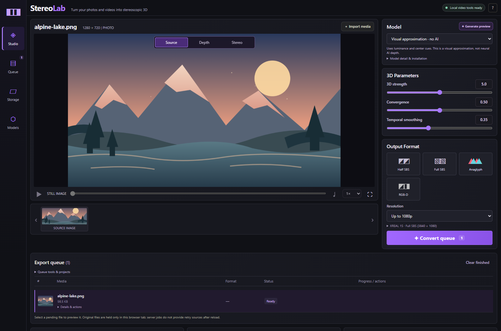
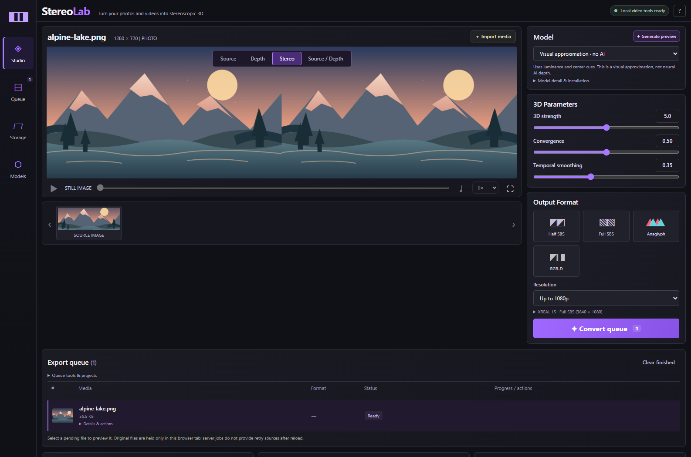

buymeacoffee.com/bosscube194

# StereoLab

A local Windows workspace for converting photos and videos into stereoscopic 3D. This version adds downloadable neural depth models, real processed-frame previews, depth presets, temporal smoothing, and depth/RGB-D exports to the original clean-room prototype.

## License

StereoLab's original source code and documentation are licensed under the MIT
License; see [LICENSE](LICENSE). You may use, modify, and redistribute those
materials, including commercially, while retaining the copyright and license
notices. This license does not cover third-party software, model weights or
exports, or FFmpeg; each keeps its own terms. In particular, the Base and Large
depth models are marked non-commercial, and the rights for one published ONNX
conversion remain unclear. Review [RELEASE_DEPENDENCIES.md](RELEASE_DEPENDENCIES.md)
before redistributing model files or a packaged executable.

## Run

Python 3.10+ is required. From this folder:

```powershell
python -m venv .venv
.\.venv\Scripts\python.exe -m pip install -r requirements.txt
.\run.ps1
```

Open [http://127.0.0.1:8765](http://127.0.0.1:8765). The launcher prefers this project's `.venv-gpu` when installed, then `.venv`. If an older server is already using that port, stop that server or use another port:

```powershell
.\.venv\Scripts\python.exe -m uvicorn main:app --host 127.0.0.1 --port 8766
```

## Windows executable

Build the standalone, 64-bit Windows executable with the DirectML runtime:

```powershell
.\setup-gpu.ps1
.\build-exe.ps1
.\dist\StereoLab.exe
```

The executable runs the local web app; open [http://127.0.0.1:8765](http://127.0.0.1:8765).
Depth models download on demand and are stored under `%LOCALAPPDATA%\StereoLab`;
they are not bundled into the executable. Video conversion also needs FFmpeg. The
app detects FFmpeg on `PATH`, `VIDEO3D_FFMPEG`, or an already installed local helper.
The frozen app stores uploads and outputs under the same StereoLab local-data folder.
One-file extraction can make the first launch slower, and Windows may show a warning
for an unsigned PyInstaller executable.
The `setup-gpu.ps1` and `build-exe.ps1` commands above are for developers building
from source; packaged users do not run them. First neural-model installation needs
internet access and an explicit Install action. A model becomes ready after
its pinned size/SHA-256 and inference checks pass. Clean-Windows first-run behavior
is still under release review; see `RELEASE_READINESS.md`.

Prebuilt Windows beta downloads are published on the [GitHub Releases page](https://github.com/Boss720/3d/releases).

## Screenshots

The screenshots use a generated sample illustration. The processed preview shows
StereoLab's visual-approximation mode, which uses image cues and is not a neural
depth model.





## NVIDIA GTX GPU and CPU cooperation

For Windows GPU acceleration, run `.\setup-gpu.ps1` once, then restart with `.\run.ps1`.
The setup creates a separate `.venv-gpu` environment containing ONNX Runtime DirectML;
it preserves the CPU environment and model cache. Do not install `onnxruntime`,
`onnxruntime-gpu` and `onnxruntime-directml` into the same environment because they
share a Python module. GPU setup uses `requirements-gpu.txt`, rather than the CPU file.
To use the GPU environment on the currently open port explicitly:

```powershell
.\.venv-gpu\Scripts\python.exe -m uvicorn main:app --host 127.0.0.1 --port 8766
```

The GTX 1650 Ti works through DirectML/DirectX 12; RTX hardware, TensorRT and a CUDA
toolkit are not required. DXGI enumeration selects the actual NVIDIA adapter: this
machine has AMD graphics at index 0 and the GTX at index 1. ONNX Runtime's registered
provider is a capability signal; the UI reports verified inference separately.

Processing device choices:

- **Auto** uses GPU depth if usable and overlaps the CPU video stages. If the GPU
  cannot run the model, it uses CPU depth and reports the reason.
- **GPU + CPU / hybrid** requires the NVIDIA DirectML adapter for neural depth:
  software decode/resize (or optional AMD decode), NVIDIA inference, then CPU refinement, temporal filtering, stereo
  rendering and FFmpeg encoding. Two bounded queues preserve frame order. GPU failures
  are reported instead of silently switching neural inference to CPU.
- **NVIDIA GPU** also requires the NVIDIA adapter and reports depth-inference failures.
  The remaining processing is CPU, sequential around inference. Unsupported ONNX
  operators may still run on CPU within the GPU session.
- **CPU only** uses CPU for depth inference and media processing. Video encoding may
  still use NVIDIA NVENC when the local FFmpeg check succeeds.

Only one model/session is resident in each server, with a single inference call at
a time. All built-in named models can attempt DirectML, including Large on a 4 GB
card. GPU input dimensions are normally capped at 924 pixels on the longer side;
Large is capped at 518 pixels on adapters with 4 GB or less to reduce its activation
memory. Start Large at 256 px neural detail and close other GPU-heavy apps. VRAM use
remains best effort because DirectML has no hard memory cap. Auto retries on CPU if a
GPU session or inference fails; GPU + CPU and NVIDIA GPU modes report the failure.
Small remains the recommended 4 GB model for speed. Approximation and
custom ONNX remain CPU engines.

The pipeline overlaps different stages, rather than running duplicate CPU/GPU
depth predictions. Decoder/inference callbacks finish their current operation on
cancellation; encoder termination releases pipe writes, and pipeline workers are
joined before the job ends. Temporal smoothing remains ordered on the CPU.

Video exports automatically use NVIDIA NVENC when the configured FFmpeg completes
a small local encode check for the chosen quality profile. That result is cached for
the current FFmpeg binary; unavailable or failed NVENC falls back to libx264, and a
later NVENC export failure retries the video with the CPU encoder. The queue shows
which encoder actually produced each export. `Fast` favors shorter encoding time;
`High quality` takes longer and can produce larger output.

The strongest speed controls are the depth model, neural input detail, source
resolution, and video length. Start with Depth Anything V2 Small; lower input detail
often reduces inference work, while 518 can preserve more fine depth detail. The
fastest size depends on source shape and runtime. Before the static-shape optimization, 15 warmed
Small-model runs on a 240x400 source measured GPU medians of 0.133/0.181/0.263 s at
256/384/518 px, while CPU medians were 0.277/0.205/0.401 s. Treat these as one
workload, not a universal ranking. `Up to 1080p` caps large sources; `Match source`
keeps their full dimensions and takes more work. More video frames mean proportionally
more processing. The encoder preset also matters, while 3D strength, convergence and
depth inversion have negligible cost. Edge refinement and temporal smoothing add
smaller CPU work per frame. Custom ONNX models may have a fixed input shape, in which
case their model's required size takes precedence.

Encoder-only medians on this GTX with a generated 90-frame 1080p clip were 0.952 s
for the previous libx264 `medium` preset, 0.470 s for the new CPU `veryfast` preset,
and 0.690 s for NVENC `p4`. NVENC offloads encoding and beats the old preset in this
test, but the faster libx264 preset won; total depth conversion time also includes
inference and stereo rendering.

For videos, the queue begins estimating after it has observed at least five frames
over two seconds, then reports remaining time, measured FPS and elapsed time from the
actual job. The estimate adapts as the conversion runs; short clips, still images and
videos without a reliable frame count do not get a fabricated remaining time.

Before static-shape optimization, a 100-frame Small-model test on this GTX measured warmed median inference
of .214 s on GPU versus .414 s on CPU, for one 400x240 synthetic source (518x308
model input). Profiling contained DirectML and CPU kernel events. The highest
sampled whole-device memory reading was 302 MiB; this is not a universal peak or
memory guarantee. Cold graph compilation, model loading, larger inputs, video
processing and other GPU applications can change timing and memory use.

## Convert

1. Install a model from **Depth models**, or choose **Visual approximation** to work without a download.
2. Add photos or videos; select a file in the queue to preview it.
3. Choose a preset, output format, strength and convergence. Strength 0 gives identical eye views. Convergence selects the zero-parallax depth plane.
4. Use **Generate preview** to process the current photo/video frame. Inspect Stereo or Depth map. Strength, convergence, layout, inversion and refinement edits reuse valid inferred depth; changing the frame, engine, input detail or execution settings invalidates it. Temporal smoothing only applies during video export.
5. Convert the queue and download the results. Completed files remain in `outputs/`.

Paths such as `outputs/`, `.runtime/models/`, quarantine folders and calibration
reports are relative to the repository root for source runs. In the packaged app,
they are relative to `%LOCALAPPDATA%\StereoLab`.

Media stays on the local server. Only model installation contacts Hugging Face. Model weights are stored in `.runtime/models/`. Uploaded conversion sources are removed when processing finishes. If Windows locks a temporary file or prevents its removal, the queue shows a cleanup warning and preserves the file; other jobs continue. Close apps using that file and check local data-folder permissions. The queue survives browser refresh while the server is running; source files must be added again for previews after refresh. Temporary queue-loading failures retry automatically with a delay capped at 30 seconds; **Refresh status** also refreshes the queue immediately. Queue state is not retained across server restarts; completed files remain on disk. Clearing the browser's finished list does not delete exports.

## Depth engines

| Engine | Download | License | Runtime |
|---|---:|---|---|
| Depth Anything V2 Small | 99 MB | Apache-2.0 | CPU/DirectML GPU; recommended for 4 GB cards |
| Depth Anything V2 Small FP16 | 49.6 MB | Apache-2.0 | Optional reduced-precision weights; slower than optimized FP32 in the local GTX test |
| Depth Anything V2 Base | 389 MB | CC-BY-NC-4.0 | CPU/DirectML GPU; non-commercial weights |
| Depth Anything V2 Large | 1.34 GB | CC-BY-NC-4.0 | DirectML attempted at 4 GB with 518 px cap; Auto can fall back to CPU |
| DPT Hybrid / MiDaS | 533 MB | Apache-2.0 (Intel upstream; conversion terms need review) | CPU/DirectML GPU; 384 px inference |
| Custom ONNX | Your file | Your model's license | OpenCV DNN CPU |
| Visual approximation | None | App code | Image cues; **not neural AI depth** |

Downloads honor configured HTTPS proxies. If a loopback proxy refuses the connection, StereoLab retries the pinned request directly over HTTPS; any installed file still must pass its pinned size, SHA-256, graph-load, and inference checks. Rejected partial files are retained under `.runtime/models/_quarantine/` for inspection. Only one neural session is kept resident, and inference is serialized to bound memory use.

Named models use their own preprocessing. Depth Anything uses RGB/ImageNet normalization with aspect-preserving, multiple-of-14 sizing (nominal 518); MiDaS uses its 384 px/0.5 normalization. Both produce relative inverse depth: brighter means nearer. Custom models must accept a float32 RGB NCHW batch with square 256/384/518 input, ImageNet normalization, and return one depth map; not every ONNX graph matches this convention.

Model provenance: [Depth Anything V2](https://github.com/DepthAnything/Depth-Anything-V2), [Small ONNX export](https://huggingface.co/onnx-community/depth-anything-v2-small), [MiDaS ONNX export](https://huggingface.co/Xenova/dpt-hybrid-midas), [MiDaS upstream](https://huggingface.co/Intel/dpt-hybrid-midas). The ONNX conversions are published by ONNX Community/Xenova, rather than the original model authors. The Intel model card states Apache 2.0, but the Xenova conversion page does not visibly state a separate license; see `RELEASE_DEPENDENCIES.md` for the pinned source revisions and review status.

## Formats and controls

Full/half SBS, full/half top-bottom, cross-eye, red/cyan anaglyph, depth-only, and color-plus-depth side-by-side are available. The `XREAL_SBS` profile writes full side-by-side at 3840x1080 (1920x1080 per eye), matching [XREAL's One Series Full SBS frame size](https://tutorials.xreal.com/docs/glasses/one-series/osd/3d-mode/). Videos export H.264/AAC MP4; photos export PNG. Depth exports are normalized 8-bit grayscale, not metric depth or a lossless depth archive. Resolution limits apply per eye; full SBS doubles the encoded width. Video exports preserve decoded frame count and nominal frame rate, and include original audio where available. Variable-frame-rate timing is converted to a constant rate; HDR, subtitle tracks and spatial metadata are not preserved. Physical playback on XREAL 1S glasses has not yet been verified.

Fine tuning offers inversion, luminance-guided edge refinement, and motion-gated temporal smoothing with scene-cut resets. These are practical filters, not a learned video-depth model. Inverse warping can stretch occlusion edges; it cannot reconstruct hidden surfaces. Similar-color motion can leave smoothing lag. Default browser previews use a 960x540 JPEG proxy. Full-detail stills preserve the decoded source within the limits below; neural input remains independently capped. Containers/codecs unsupported by the browser can still be decoded for export by FFmpeg.

## FFmpeg

Video exports need FFmpeg with `libx264`. Detection checks `VIDEO3D_FFMPEG`, then PATH, then an already-installed Owl3D FFmpeg utility as a local convenience. The utility is not copied or redistributed. To use your own:

```powershell
$env:VIDEO3D_FFMPEG = 'C:\Tools\ffmpeg\bin\ffmpeg.exe'
.\run.ps1
```

## Roadmap runtime improvements

GPU capabilities are versioned in `runtime.capabilities`; the frontend does not
infer support from prose. Unknown adapter memory follows the conservative Large
518 px cap. After a failed GPU attempt, Auto suppresses repeated attempts for
the same model, adapter and input settings for 60 seconds. **Retry GPU** clears that
suppression and the preview cache after any active inference finishes. GPU + CPU and
NVIDIA GPU modes report failures strictly. Actual model dimensions, input cap,
provider and successful inference are reported separately.

Preview depth uses a process-local LRU with at most eight entries and 32 MiB of
depth buffers; metadata and temporary images use additional memory. It stores raw
depth before inversion/refinement. Model identity, preprocessing, frame pixels,
input settings and runtime identity participate in cache keys. Transient neural
CPU fallback results are not cached. Cached tuning remains available during an
export; new neural preview requests report busy while a neural export is active.

Conversion preflight checks readable media/first video frame, output dimensions,
writable destination, disk reserve and video libx264 availability before loading
the depth model. Disk estimates and warnings appear in the queue and do not
guarantee that an export will fit. Later corrupt frames or encoder failures can
still fail a conversion. Existing active jobs are not restarted by diagnostics.

Video telemetry separates initialization, conversion and finalization, records
encoder restart reasons and bases ETA on up to 32 recent frame observations.
Observed variability can produce an approximate range; stalls affect the estimate.
Finalization has no invented remaining time. This is an active-job estimate, not
a queue completion estimate. Stage service and queue-wait times can overlap and
must not be added to obtain elapsed wall time. Queue waits include operation overhead.

**Performance presets** provide Fast, Balanced, Quality and Conservative 4 GB
starting settings, with the exact values visible. Reset restores the selected
preset; edits show an unsaved indicator.
The **Saved settings** panel stores up to 20 named configurations in this browser;
mark favorites to show them first. Applying one changes the visible controls only
and does not start a job. Export/import settings uses schema v1 JSON and rejects
unknown fields, obsolete schemas and invalid values before applying. The 4 GB
preset is a conservative starting point, not a memory guarantee.

**Measure input detail** is opt-in for named Depth Anything models. Choose a 5,
15 or 30 second budget. It warms each input size, collects two comparable samples,
and reports the fastest measured depth input only when evidence is complete.
Decode, setup and warmup count against the budget; a running inference cannot be
interrupted and may overrun it. Results never change settings automatically.
**Apply measured input detail** requires an explicit click and unchanged context.
Lower detail can lose fine edges. This does not calibrate models, encoders or whole
exports, and MiDaS has fixed input dimensions. Up to 16 reports are saved atomically
in `.runtime/calibrations.json`; no old measurement is applied automatically.

Preview zoom/pan is shared across views (1x-4x). Focus the preview and use +/-,
arrow keys and 0 to reset, or drag a zoomed view. **Source / Depth** reveals two
images from the exact processing frame sent to inference and labels its dimensions.
It never compares a processed result against a newly sought live video frame.
**Still detail → Full-detail still** sends the original image file instead of a
JPEG capture: at most 12,000,000 decoded pixels, 8192 pixels per side and 24 MiB.
The full source is retained for rendering and Source/Depth comparison; this does
not raise the model's hardware input cap. Dimension limits are checked after
decode, so they are not a guarantee of peak process memory. Large raw-depth
arrays can exceed the cache budget and are then deliberately not retained.

**Processed clip preview** explicitly uploads the original selected video and
prepares a 1–5 second interval from its current timestamp. Preparation uses a
separate H.264/AAC proxy of at most 960x540, 24 fps and 120 frames, followed by
the normal export pipeline and selected refinement/temporal settings. History
starts fresh at the interval boundary. Proxy re-encoding changes source pixels;
the result does not promise pixel identity with a full-source movie export.
Uploads and preparation can dominate the time for large files. Clips queue
behind existing work, can be canceled, and stale source/settings/timestamp/length
results are hidden and canceled where still active. The output player is muted
and does not start automatically. Codec support is needed in the browser to
select a timestamp. Clip jobs use a separate preview area, and the API explicitly
advertises support so an older server cannot silently export the whole movie.
Very slow sources use at least 1 fps in the proxy. Sparse source frames, seeking
or the end of a file can yield a shorter playable clip; actual frames/FPS are
reported separately from the requested source interval.

Queue rows show their exact settings snapshot, actual device/provider, encoder,
phase and fallback. Before upload, files use the visible controls unless you
explicitly freeze their settings and output name; **Apply settings + name to ready
files** freezes the batch. Frozen files are checked against their own engine and
device settings even when the visible controls change. Move ready files up/down
to choose submission order. Supported servers
also allow pending exports to move, receive current settings, or be removed.
An export already taken by the worker rejects queued edits, and queued preview
clips keep their place when exports move. A changed queue prompts a refresh.

**Use settings** loads a snapshot into the controls without starting work.
Retry and duplicate prepare a new ready item only when the original File remains
in this browser tab. After refresh, reselect the original source; server jobs do
not retain completed uploads or match files automatically by name. Active jobs
are unaffected by changes to the visible controls. Queue state is still in memory
and does not survive a server restart. New outputs use the full job UUID and an
exclusive reservation; a preexisting target is preserved and reported as a conflict.
Existing exports keep their names.

**Enable completion notifications** requests browser permission only when you
click it and enables notices for the current tab. Each reload starts with notices
off; existing completed jobs and processed clips never trigger them. Browser/OS
permission and delivery vary. Queue processing continues if a notice cannot be
shown. **Alt+P** generates the current still preview and **Alt+Enter** submits the
ready queue when their buttons are enabled. Shortcuts ignore editable fields,
open dialogs, held-key repeats and IME composition.

On supported servers, output filename templates accept `{name}` (source stem),
`{layout}`, `{model}` and `{date}` (job creation date in UTC, YYYYMMDD). The default
is `{name}_{layout}`. Names are sanitized and bounded; the full unique job ID and
PNG/MP4 extension are always added. Templates cannot choose folders or formatting
expressions. Ready-file freezes include the template; retry preserves it and a
duplicate uses the current one. **Use current name** changes only a pending
server export's template, separately from its performance settings. Actual names
remain visible after completion. Clips keep their own internal preview names.

The bounded `scripts/isolate_gpu_variance.py --device gpu` diagnostic captures
three repeats of a pinned, generated 36-frame Small-model proxy at raw ONNX,
normalized/refined/temporal depth and rendered BGR stages. It separately repeats
libx264 and available NVENC encoding with identical input frames. It requires the
prior matched fixture and idle known local APIs, and does not change app defaults.
One local run showed tiny first-frame raw-model variation while the second and
third repeats matched exactly; fixed-input encoder pairs matched exactly. This
does not establish universal determinism or close the earlier clip pixel gate.

The diagnostic now captures the exact preprocessed inputs before ONNX execution
and compares all three repeat pairs. `--warmup-frames 1` requests one separately
accounted-for diagnostic inference before the measured sequence; the default is
zero. Local cold and warmed runs both showed raw GPU variation despite identical
inputs, so no production warmup behavior was adopted.
`scripts/analyze_variance_captures.py --report <report.json>` independently checks
capture hashes and stage arrays. Add `--encode` to encode each captured rendered
sequence with the saved fast profiles and compare decoded results under the
unchanged strict pixel policy. It does not run model inference. Small rendered
differences were amplified by libx264 in some experiments; tested NVENC results
were identical. These observations do not explain every earlier video difference.

The clip verifier now requires all three comparisons (ordinary repeat, clip vs
first export, clip vs repeated export) to pass and rejects missing public execution
proof. A fresh isolated GPU API run passed with all 36 decoded frames identical;
the original failed report remains preserved. This validates that generated run,
not universal repeatability or representative footage.

The server accepts loopback hosts and rejects browser writes from foreign origins
or a different service port. Local CLI calls without an Origin remain supported.
This is a local app boundary, not authentication for a public deployment.

Optional **History from previous launches** remembers ordinary export metadata,
settings and naming across server launches. Enable it before starting a new server:

```powershell
$env:STEREOLAB_HISTORY_INSTANCE = 'desktop'
.\run.ps1
```

Reuse that stable name to revisit its history. Names use lowercase letters,
digits, underscores or hyphens, start with a letter/digit, and have at most 32
characters. Only one server can own a name at a time. Unset/empty disables history;
it creates no history files and does not delete an existing store. Do not restart
a server with needed in-memory downloads merely to enable the feature.

History stores up to 1000 metadata records under
`DATA_ROOT/.runtime/history/instance-<name>/` and prunes terminal metadata after
90 days or when capacity is needed. It never deletes source/output files as part
of pruning. Completed records offer a download while the saved output is still
available and has its recorded size. Unfinished prior-launch records are marked
interrupted. **Use settings and reselect source** loads settings/naming; select
the source explicitly and submit a new export. Source files, queue order and
processing progress are not restored. History does not start work automatically.

Failed history writes show a warning; new admissions and settings/name edits are
blocked while already-admitted work and cancellation remain available. Account
for current outputs before repairing storage and restarting. History is local,
single-process metadata storage; reload/multi-worker and network filesystems are
unsupported. Source and frozen EXE data roots have separate history. The public
prebuilt beta EXE has not been rebuilt with these source changes. A private
isolated candidate includes the latest frontend edits and passed same-machine
package acceptance, focused Chromium keyboard/focus/status checks, and packaged
save-copy byte-integrity/overwrite checks. Open output folder and Reveal file
opened the isolated output directory and displayed the generated output; the
Reveal selection highlight remains unconfirmed. Same-host fresh-profile model
installation and generated neural output also passed. Screen-reader behavior
and clean-account/machine installation remain open. See
`RELEASE_READINESS.md` and `plans/job-history.md`; source retention and frame
resume remain unavailable.

DEPTH/RGB-D no longer synthesize unused stereo eyes. An alternating four-sample
1080p approximation-to-PNG benchmark measured DEPTH medians 0.321 to 0.277 seconds
and RGB-D 0.335 to 0.313 seconds, with identical PNG bytes. This measures the image
processing path, excluding upload, queue, preflight and download; it is not a
universal speedup. Reproduce with `scripts/benchmark_render_outputs.py`.

The reproducible API benchmark uses synthetic fixtures (not visual-quality ground
truth), validates output and reports comparable-run medians/ranges:

```powershell
.\.venv-gpu\Scripts\python.exe scripts/benchmark_roadmap.py --base-url http://127.0.0.1:8768 --model balanced --device cpu --repeats 3
```

Reports and generated fixtures are kept under ignored `.runtime/` directories.
Use `--sample-resources` to opt in to server process CPU/working-set snapshots and
bounded whole-device NVIDIA memory sampling. Process working-set peaks cover the
server lifetime; sampled device memory includes other applications. Neither is an
exact per-job VRAM allocation peak, and diagnostics add measurement overhead.
Named models must already be installed. Use `--model depth-anything-v2-small
--device gpu` or `--device hybrid` for matched hardware runs. Missing measurements
remain explicit; short synthetic clips do not establish sustained speed or peak VRAM.

`scripts/verify_roadmap.py --base-url http://127.0.0.1:8770 --device gpu` checks
cache reuse/invalidation and opt-in calibration against an idle running server.
`scripts/compare_renderer_quality.py` and `scripts/compare_temporal_quality.py`
retain unpromoted quality experiments under `.runtime/quality-verification/`.
Measured costs and mixed synthetic evidence do not support selecting them by default.

`scripts/stress_roadmap.py --base-url http://127.0.0.1:8770 --sample-resources`
generates a deterministic 30-second pan/thin-detail/cut/low-light/audio fixture,
then runs all four installed models sequentially on explicit GPU at requested
detail 518. MiDaS remains fixed at 384x384. The local GTX run completed all four
360-frame exports and separate cancellations; reports are incremental under
`.runtime/stress-verification/`. This generated workload does not establish
representative real-footage quality, multi-hour stability or an exact VRAM peak.
The runner requires an idle server; API cancellation/download checks alone do
not establish OS encoder-process cleanup.

## Verification

Production release status and the remaining correctness checks are tracked in
[RELEASE_READINESS.md](RELEASE_READINESS.md). Timestamp-aware VFR conversion now
passes generated mixed-rate and missing-PTS checks; real-footage audio sync and
wider codec/driver coverage remain open.

The local server accepts `--port` (1–65535), for example
`.\dist\StereoLab.exe --port 8770`; it always binds to `127.0.0.1`.
The queue accepts at most 32 pending jobs, four simultaneous application upload
copies, and 512 session records. A full session requires finishing active work
and restarting; saved outputs remain on disk. Multipart receiving has a separate
four-request admission cap before parser body reads; excess recognized requests
are rejected before parsing. This is separate from the application upload-copy
limit.

```powershell
.\.venv\Scripts\python.exe -m pip install -r requirements-test.txt
.\.venv\Scripts\python.exe -m unittest discover -s tests -v
node --check static/app.js
```

The semantic tests use fake model sessions/downloads plus real approximation image processing. For a live integration check, install Small, run the server on 8766, then run `.\.venv\Scripts\python.exe scripts/smoke.py`. That check performs real Small inference, matches preview/export pixels for an identical frame, verifies image/depth/RGB-D outputs, and checks video dimensions, frames, frame rate, audio and cancellation. Synthetic fixtures and a report are retained in `.runtime/verification/`.

GPU checks use `.\.venv-gpu\Scripts\python.exe scripts/benchmark_gpu.py` (CPU/GPU
comparison, 100 GPU inferences, provider profiling and sampled nvidia-smi memory).
After the smoke check creates a source video, `scripts/verify_devices.py` exercises
CPU/GPU/hybrid exports and compares decoded frames. Install `httpx` into the chosen
verification environment if needed. Reports remain in `.runtime/gpu-verification/`.

StereoLab is independent of Owl3D. It does not reuse proprietary Owl3D weights, processor code or account protocols, and does not claim matching output quality. Spatial/MV-HEVC, live desktop conversion, VR pairing and learned video-depth models remain outside this version. See `COMPATIBILITY_SPEC.md` and `PROGRESS.md` for scope and evidence.


### Queue scheduling, storage and completed exports

Use **Pause after current job** to let active work finish and hold subsequent jobs,
including newly submitted exports and processed clips. **Resume queue** preserves
pending order. Pending cancellation remains available while paused. Scheduling pause
is local to the current server launch; restarting resumes scheduling. This does not
pause an active video or provide interrupted-export recovery.

**Local storage → Measure storage** reports managed uploads, preview segments,
outputs and models. Select inactive temporary files explicitly before deleting;
active/staged uploads and active-job proxies are protected again at deletion time.
Models and completed outputs are measured but are not offered for temporary cleanup.
A job's **Retry cleanup** action retries its recorded failed cleanup without changing
the conversion outcome. Close other apps holding files open before retrying.

**Open output folder** and **Reveal file** launch Windows Explorer for validated
managed paths. To save elsewhere, enter an existing writable folder under Local
storage, then use **Save copy** on a completed job. Copies never overwrite an existing
file; the managed original stays available for history/downloads, so copies consume
additional storage. Direct conversion to a custom destination remains planned.

### Optional video depth reuse

Enable **Advanced settings & tools → Fine tuning → Reuse video depth maps** before
exporting a video with a named neural model. The setting is off by default and is
saved with queue settings, presets and projects. A completed export can retain its
native depth maps; exporting the identical source again can then skip inference
while changing strength, convergence, refinement, encoding or a layout that keeps
the same working frame dimensions. Source relinking/upload is still required.
Images, custom ONNX and processed preview clips do not populate this cache.

Changing the source bytes, model bytes, depth detail, inversion, smoothing, cadence,
working dimensions, execution mode, decoder or relevant runtime/code version causes
a miss. Each decoded frame is checked against its saved identity. If a saved
sequence does not match, the full export restarts once with fresh depth. The queue
labels a hit **Cached depth · CPU rendering**, with the original inference details
retained separately; a hit makes no new GPU inference claim.

Maps retain exact float32 values after native temporal filtering, before upscale,
edge refinement and stereo rendering. Storage is uncompressed and bounded by a
**2 GiB quota**, including partial writes; entries are never automatically evicted.
For the generated 24-frame Small-model check, maps occupied about **3.24 MiB** on
disk. At the same native shape, 30 FPS would require roughly **243 MiB per minute**
before manifest overhead; dimensions and detail can change this substantially.
Quota exhaustion, a locked cache or disk failure warns and continues conversion.
After the first map, the queue shows an estimated total when the frame count is
known; a projection larger than the quota skips caching immediately.
Failed, canceled and temporary CPU-fallback attempts do not publish a new entry.
An unavailable cache directory does not prevent application startup.

Use **Local storage → Refresh cache** to review exact disk usage, quota, active
entries and incomplete-file warnings, then select entries to remove. Inactive
partials are selectable; active reads/writes are protected, including from another
StereoLab process sharing the folder. Cleanup failures remain visible and retryable.
Cache data lives in `.runtime/depth-cache` under the app data directory.

Reproduce the bounded real-model check without downloading weights or starting a
server: `.\.venv-gpu\Scripts\python.exe scripts/verify_depth_cache.py --execution-mode gpu`.
It generates a short video with audio, counts real inference calls and fully
decodes exports. Two local GTX repeats each used 24 inferences to populate and
zero for each hit; the same-settings hit matched encoded video, decoded pixels and
audio exactly. This verifies reuse on generated media; long films, variable frame
rate and packaged neural-cache behavior need further validation.

Video exports now reuse job-owned stereo-warp scratch buffers and pack XREAL output
into one combined canvas. Matched outputs are unchanged. Three short CPU-only
approximation/XREAL export pairs showed a local median of 2.300 versus 2.088 seconds;
this is not a promised gain for other footage or GPU inference. See
[measurement scope and raw evidence](output/reviews/render-optimization-2026-10-20.md).

When temporal smoothing is zero, the video path also skips unused history copies.
In three matched synthetic CPU exports, the median fell from 4.406 to 4.349 seconds
with identical encoded files, decoded frames and audio. A 1080p filter microbenchmark
showed a 28.7% lower median for that filter stage. Reproduce both measurements with
`scripts/benchmark_temporal_history.py`; these local synthetic results do not predict
neural/GPU or general-footage speed.

### Saved projects

Use **Save project** to download a portable `.stereolab-project.json` containing the
ready queue order, frozen per-source settings, output naming and selected video
preview time. The file stores each source's basename, media type, size and SHA-256
fingerprint; it does not contain media bytes or absolute paths. Saving reads each
source in bounded chunks in a background worker. **Open project** appends unresolved
source rows without starting work. Use **Locate source** to choose each original;
StereoLab verifies its full content before making it ready. The server checks the
fingerprint again while staging the upload, so changed content is rejected before
queue admission. Keep the original media separately; projects do not copy or retain
source files, and persistent video-depth caching remains planned.

### Neural video speed options — 21 October 2026

DirectML sessions now lock the actual input tensor dimensions using named free
dimension overrides. A changed aspect ratio or input detail replaces the single
resident session. The GPU path derives a versioned, hash-verified local graph
with cubic ONNX Resize nodes changed to linear; upstream weights remain intact.
The variant and both hashes appear in execution metadata. This interpolation
change can change depth: the Small-model sample had normalized depth MAE 0.00785
against the original. Model-derived variants consume additional model-cache disk
space. Update the selected environment from its requirements file for the new
`onnx` dependency, then restart the app.

Named neural video models now smooth depth and detect cuts at network-output
resolution before upsampling. Edge refinement still uses the full source image.
In **Fine tuning → Video depth cadence**, choose **Alternate frames + optical
flow** to infer frames 1, 3, 5… and warp depth for intervening frames with CPU DIS
flow. Cuts, size changes, invalid flow and poor alignment trigger fresh depth.
Every source frame is still rendered and encoded. Flow is opt-in: moving edges,
occlusions and newly revealed objects can lose depth detail. The queue reports
actual neural/flow counts; images always use one estimate.

The model picker also offers separately installed **Small FP16** weights. Its
49,642,442-byte file is pinned to the same upstream revision as Small, with its
own hash and acceptance check. FP16 was slower on this GTX/DirectML workload, so
FP32 remains recommended. The model's external input is float32 even though its
weights use FP16; preprocessing follows the graph's declared input type.

**Fine tuning → Video decoder → AMD graphics** explicitly requests FFmpeg
D3D11VA on a detected physical AMD DXGI adapter. Adapter 0 worked on this laptop;
the code discovers the ordinal instead of assuming it. Startup failure falls
back to software and reports why. Midstream decode errors fail the job. Software
remains the default: three 120-frame 720p H.264 decode pairs measured median full
wall times of 0.534 s (OpenCV) and 0.924 s (AMD), including equal hashing work,
startup and cleanup. GPU downloads can outweigh decoding savings. AMD/software
pixels also differed (MAE 1.03/255), so they do not have byte parity.

Matched complete exports on the GTX 1650 Ti, three repeats per variant:

| Variant | Median export wall time |
|---|---:|
| Original dynamic FP32 and full-size temporal filter | 4.323 s |
| Static/linear FP32 and native-size temporal filter | 1.602 s |
| Same FP32 path with alternate-frame flow | 1.150 s |
| Static/linear FP16 and native-size temporal filter | 2.597 s |

These were synthetic 24-frame 640×360, 12 FPS sources, 256 px requested neural
detail, 1280×360 SBS output, software decode/libx264 encode and warmed model
sessions. All 12 outputs decoded to 24 frames at 12 FPS with identical decoded
audio. Each flow run used 12 neural and 12 flow frames. Pixels differ between
quality-changing paths; these measurements do not establish real-footage quality
or sustained whole-film speed. Reproduce with
`.\.venv-gpu\Scripts\python.exe scripts/verify_neural_speed.py`.

A separate five-repeat warm Small inference profile at 252×420 input measured
149.9 ms dynamic, 39.9 ms static and 31.7 ms static/linear. Static profiles had no
recorded CPU-provider kernel events in this sample; this does not prove zero CPU
work for every model/shape. FP16 static/linear measured 73.4 ms. The temporal-only
microbenchmark measured 96.5 ms at 1080p versus 4.0 ms at 252×448; resizing,
inference, refinement and rendering are outside that filter measurement.
`scripts/benchmark_directml_variants.py` and `scripts/verify_amd_decoder.py` retain
their raw reports under `.runtime/`, as does the complete-export script.

Runtime references: [DirectML shape guidance](https://onnxruntime.ai/docs/execution-providers/DirectML-ExecutionProvider.html),
[ONNX Resize modes](https://onnx.ai/onnx/operators/onnx__Resize.html),
[pinned FP16 source](https://huggingface.co/onnx-community/depth-anything-v2-small/blob/4472b7362082ad9968fee890ca0f1e5aca36b93d/onnx/model_fp16.onnx),
[FFmpeg hardware acceleration](https://ffmpeg.org/ffmpeg.html#Advanced-Video-options).
